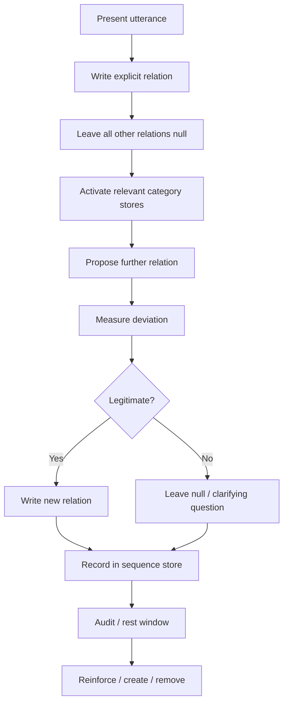
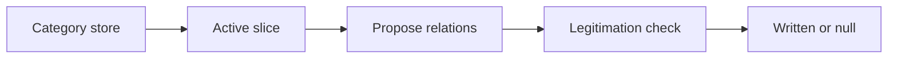
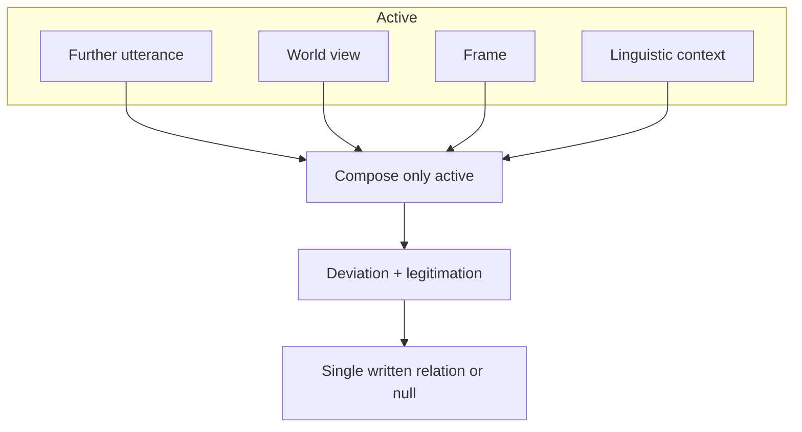

# S2M Relational Mapping Proposal

**Date:** 2026-11-19
**Status:** Proposal. Independent of current requirements definitions of meaning. Not a definitive account.
**Door:** This page is linked from the short-sim README so a Frontier AI or new session can find it.
**Implementation contract:** [s2m_program_reference.md](s2m_program_reference.md) — concrete data shapes, attachment point, non-mutation rules, and first-seed acceptance criteria. Read both before coding.

## Why

Structure-to-meaning is currently fuzzy because the bridge constructs have not been made visible. The goal is a legitimate growth path that starts from a seed (one explicit relation + explicit nulls) and expands only through controllable legitimation. Meaning sits in relations that are present and relations that remain only potential. This proposal records the process that emerged from discussion so it can be seen, trained, and scaled without inventing links.

## How

- Pre-train six category stores independently.
- At runtime activate only the relevant subset for the current exchange.
- Write the explicit relation the present structure establishes; leave all others null.
- Propose further relations only from active categories.
- Measure deviation from the licensed region.
- Legitimate or refuse: write only if it fits the composite world view; otherwise leave null (or emit clarifying question).
- Audit (periodic, continuous, or rest/sleep window) for coherence, deviation size, unlegitimized links, and null stability.
- Engineering operations: reinforce, create (only after legitimation), or remove.

## Expected size

| Scope | Projected relations |
|-------|---------------------|
| Rudimentary (seed + core everyday) | ~10⁴ |
| Single broad culture + common occupations | 10⁵ – 10⁶ |
| Multiple cultures + specialized domains | 10⁶ – 10⁷ |
| Open-ended | grows with training |

Runtime memory stays proportional to active categories and legitimized relations, not library size.

## Categories

1. **Further utterance** — local continuations and clarifying forms.
2. **World view** — a priori noun–relation map (basic library lives here).
3. **Social / situational frame** — roles, politeness, setting.
4. **Linguistic context** — anaphora, contrast, scope, force.
5. **Legitimation / refusal** — question, correction, agreement/refusal signals.
6. **Time / sequence** — deviation windows, recency, re-opening.

Each can be loaded or trained separately. Overlap is handled at runtime by activating only relevant categories and materializing composition only for relations under check.

## Merge / overlap handling (efficient)

- Separate stores.
- Lazy composition: pull only active slices; overlap exists only during the deviation-and-legitimation check.
- Reference, don’t copy.
- Nulls occupy only a marker.
- Active memory ∝ relations actually used.

## Scale capability

The structure is the same at every size. Growth occurs only by additional relations passing through the same legitimation step. No new category or write path is required. Seed state (one written relation + nulls) remains a legal state at any scale.

## What portion is trained / what we train on

- **Trained:** each category store independently (a priori maps).
- **Train on:** observed or curated relations within that category (everyday objects/events for world view; common continuations for further utterance; etc.).
- **Not pre-trained:** every possible path. Plasticity allows new relations to be legitimized later.
- **Runtime:** only relevant categories are activated; unused stores stay cold.

## Noun vs verb / relationship

Nouns are only endpoints. Meaning is the relation that is written and the relations that remain potential. The process is relational: write the present connection, leave further connections null until legitimized. Object/attribute collection is not the bridge.

## What the mapping depends on

Observation of the mapping from structure to meaning: the single relation the floor emits, the explicit nulls, the deviation of any proposed continuation, and the legitimation decision. The first visible bridge is that observation made re-runnable.

## Block diagram — mapping process

## Block diagram — single category

## Block diagram — multiple categories (overlap)

## Plasticity of the mind

The mind is trained (a priori maps) yet plastic. New relations can be built controllably: unexpected continuation → deviation check → legitimation against composite world view → write or refuse. Not every path must be pre-trained.

## Audit, safety, down time

- **Audit:** periodic, continuous, or both. Inspects coherence of written relations, deviation sizes, unlegitimized links, null stability.
- **Safety:** only legitimized relations are written; clarifying question is the response to large deviation; engineering view can remove unwanted links.
- **Down time / rest / sleep:** protected window for thorough audit and light reorganization without response load.

## Relationships established in conversation

Relations can be written during the exchange itself when a clarifying step legitimizes them. Example:

- Speaker: “The sky is blue.”
- Packet writes: sky – is – blue. All further null.
- Speaker: “meaning it is hot.”
- Listener / system: “What do you mean by, it is hot?” (deviation; relation not yet written).
- If subsequent information legitimizes a link, it is written; otherwise it stays null.

Further examples:
- “Where is the book?” → query relation written; locative continuation remains potential until answered.
- Social frame shift (formal vs casual) activates different frame slice; same sentence can license different continuations.

## Traceability

This proposal is the emerging S2M mapping. It is not yet implemented. The short-sim door points here so the process can be found. Current goal in status.md remains the first visible seed (one relation + nulls).

Implementation details sufficient for correct coding live in [s2m_program_reference.md](s2m_program_reference.md).
