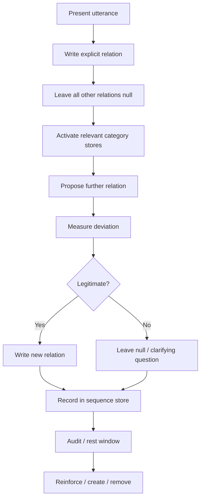
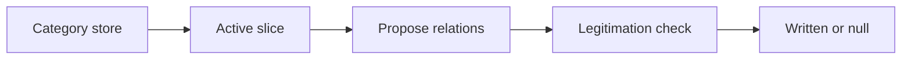
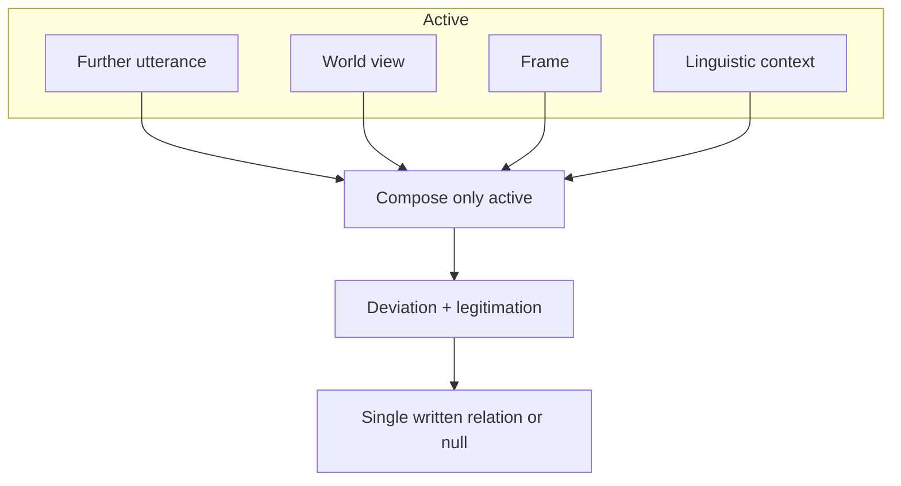

# S2M Relational Mapping Proposal

**Date:** 2026-11-19  
**Status:** Proposal. Independent of current requirements definitions of meaning. Not a definitive account.  
**Door:** This page is linked from the short-sim README so a Frontier AI or new session can find it.  
**Implementation contract:** s2m_program_reference.md — concrete data shapes, attachment point, non-mutation rules, and first-seed acceptance criteria. Read both before coding.

## Why

Structure-to-meaning is currently fuzzy because the bridge constructs have not been made visible. The goal is a legitimate growth path that starts from a seed (one explicit relation + explicit nulls) and expands only through controllable legitimation.

Meaning sits in relations that are present and relations that remain only potential. This proposal records the process that emerged from discussion so it can be seen, trained, tested, and scaled without inventing links.

A central observation is:

> **The word interpretation list is where meaning slips in.**

This does not mean that an interpretation list is *the meaning* of a word or sentence, nor that knowing the list means knowing or understanding the meaning of an utterance. The list exposes possible meaning relations. The complete utterance constrains those possibilities toward a finite composite specific to that occurrence.

The proposal therefore distinguishes the structural relation established by the floor from the possible interpretations made available downstream and from the composite selected for the utterance.

## How

- Pre-train six category stores independently.
- At runtime activate only the relevant subset for the current exchange.
- Write the explicit relation the present structure establishes; leave all others null.
- Expose possible interpretation relations for relevant words/endpoints.
- Organize those possibilities descriptively by major category and subcategory.
- Use the complete utterance and active space to constrain the candidate relations.
- Propose further relations only from active categories.
- Measure deviation from the licensed region.
- Legitimate or refuse: write only if it fits the composite world view; otherwise leave null (or emit clarifying question).
- Build the finite composite from the legitimized selections.
- Audit (periodic, continuous, or rest/sleep window) for coherence, deviation size, unlegitimized links, and null stability.
- Engineering operations: reinforce, create (only after legitimation), or remove.

## Expected size

| Scope | Projected relations |
|-------|---------------------|
| Rudimentary (seed + core everyday) | ~10⁴ |
| Single broad culture + common occupations | 10⁵ – 10⁶ |
| Multiple cultures + specialized domains | 10⁶ – 10⁷ |
| Open-ended | grows with training |

Runtime memory stays proportional to active categories and legitimized relations, not library size.

These are projected scaling ranges, not demonstrated capacities. The implementation establishes a mechanism through which increasing relation spaces can be tested.

## Categories

1. **Further utterance** — local continuations and clarifying forms.
2. **World view** — a priori noun–relation map (basic library lives here).
3. **Social / situational frame** — roles, politeness, setting.
4. **Linguistic context** — anaphora, contrast, scope, force.
5. **Legitimation / refusal** — question, correction, agreement/refusal signals.
6. **Time / sequence** — deviation windows, recency, re-opening.

Each can be loaded or trained separately. Overlap is handled at runtime by activating only relevant categories and materializing composition only for relations under check.

These six stores describe sources involved in the S2M process. They are distinct from the major/subcategory organization below, which describes possible **interpretations**.

## Interpretation space: where meaning slips in

The structural floor can establish a relation such as:

```text
sky — is — blue
```

That relation does not exhaust what the utterance may mean.

Words participating in the relation can expose sets of possible interpretations. For the rudimentary example, candidate lists may include:

```text
blue = {
  sadness,
  depression,
  cold,
  dying/dwindling,
  pristine,
  expansive,
  clarity,
  color,
  primary color
}
```

```text
sky = {
  openness,
  higher,
  no boundaries,
  broadening,
  free,
  made of gas,
  surrounds a planet,
  generally seen from the ground and looking up
}
```

These lists make the transition toward meaning visible.

They are **not definitions of the words**. They are not individually the meaning of `"The sky is blue."` They do not establish that a system possessing the lists knows or understands the meaning of the sentence.

Instead, they expose possible meaning relations upon which the complete utterance can operate.

Conceptually:

$$
\text{structural relation}
\rightarrow
\text{candidate interpretation space}
\rightarrow
\text{utterance-specific selection}
\rightarrow
\text{finite customized composite}
$$

The phrase **“the word interpretation list is where meaning slips in”** refers to this boundary. Structure has established what is present. The interpretation lists make possible meaning relations available. The entire utterance then constrains which of those possibilities participate in the composite for this occurrence.

Therefore:

$$
\text{candidate interpretation space}
\neq
\text{selected meaning composite}
\neq
\text{claim of understanding}
$$

The proposal concerns the first two transitions. It does not require the stronger claim that producing the resulting composite is equivalent to knowing or understanding what the sentence means.

## Major interpretation categories and subcategories

Candidate associations can be organized descriptively under a major category and subcategory.

| Major | Subcategories |
|-------|---------------|
| **Affective / experiential** | emotional-tone, bodily-felt, mood, valence |
| **Perceptual / sensory** | color, spatial-extent, visual-quality, sensory-modality |
| **Physical / compositional** | material, structure, natural-kind, composition |
| **Perspectival / situational** | viewpoint, typical-context, orientation, accessibility |
| **Mental** | cognitive, attentional, conceptual, clarity |
| **Spiritual** | transcendent, unbounded, sacred-associative, elevating |
| **Social** | shared, collective, interpersonal, cultural-common |
| **Metaphysical** | ontological-status, essence, categorical-being, ultimate-ground |

**Metaphysical** is included as its own major category.

Each association from an interpretation list can sit under one major and one subcategory. The organization remains descriptive and extendable. Subcategories can be added later without requiring the major categories themselves to change.

The classification applies to the association, not necessarily to the word as an intrinsic property.

For example, the candidate associations for `blue` can occupy different regions of the interpretation space:

- `sadness` may be represented affectively.
- `color` may be represented perceptually.
- `clarity` may be represented mentally.

Likewise, different possible relations associated with `sky` can occupy physical, perspectival, mental, spiritual, or other regions.

The existence of an association in one of these regions does not make it active for every occurrence of the word. Selection remains specific to the utterance and active space.

## The customized composite

The meaning-side result is not intended to be the union of every candidate association attached to every word.

For:

> “The sky is blue.”

the system begins with the explicit structural relation:

```text
sky — is — blue
```

The interpretation lists expose multiple possible relations for `sky` and `blue`. The complete utterance constrains that larger possibility space. Only a finite subset passes through the active space and legitimation process.

That resulting finite selection is the **customized composite** for the occurrence.

Meaning is proposed to appear in that composite without requiring the stronger conclusion that the system therefore knows what the sentence means.

This gives S2M an inspectable distinction between:

1. what structure explicitly established;
2. what interpretations were possible;
3. what interpretations were selected;
4. what remained unavailable, unselected, refused, or null.

## Merge / overlap handling (efficient)

- Separate stores.
- Lazy composition: pull only active slices; overlap exists only during the deviation-and-legitimation check.
- Reference, don’t copy.
- Nulls occupy only a marker.
- Active memory ∝ relations actually used.

## Scale capability

The structure is intended to remain the same as the relation space grows. Growth occurs through additional relations passing through the same selection and legitimation process. No new category or write path should be required merely because more associations, subcategories, or interpretive spaces are available.

Seed state (one written relation + nulls) remains a legal state at any scale.

This is presently an architectural scalability proposition. Increasing relation counts must be tested to establish how far the implementation actually scales.

## What portion is trained / what we train on

- **Trained:** each category store independently (a priori maps).
- **Train on:** observed or curated relations within that category (everyday objects/events for world view; common continuations for further utterance; etc.).
- **Interpretation pools:** candidate associations organized by major and subcategory.
- **Not pre-trained:** every possible path. Plasticity allows new relations to be legitimized later.
- **Runtime:** only relevant categories and interpretation slices are activated; unused stores stay cold.

An interpretation inventory need not enumerate every meaning in advance. Its purpose is to provide an extendable relational space from which finite selections can be made.

## Noun vs verb / relationship

Nouns are only endpoints. Meaning is not reduced to object or attribute collection.

The structural floor establishes present relations between endpoints. Interpretation pools then expose possible relations associated with those endpoints. The complete utterance constrains which possibilities can participate in its customized composite.

The process therefore remains relational: write the present connection, expose possible meaning relations, select and legitimate only those appropriate to the occurrence, and leave further connections null or potential.

Object/attribute collection by itself is not the bridge.

## What the mapping depends on

Observation of the mapping from structure toward meaning includes:

- the relation the floor emits;
- the explicit nulls;
- the candidate interpretation relations made available;
- the active major/subcategory space;
- the finite selections proposed for the utterance;
- the deviation of a proposed relation;
- the legitimation or refusal decision; and
- the resulting customized composite.

The visible bridge is that process made inspectable and re-runnable.

## Block diagram — mapping process



## Block diagram — single category



## Block diagram — multiple categories (overlap)



## Plasticity of the mind

The mind is trained (a priori maps) yet plastic. New relations can be built controllably:

```text
unexpected continuation
→ deviation check
→ legitimation against composite world view
→ write or refuse
```

Not every path or interpretation must be pre-trained.

The interpretation space is therefore extensible. New associations and subcategories may enlarge what is available without requiring every possible future composite to have been enumerated beforehand.

Plasticity operates on possible relations while legitimation controls which relations become part of an accepted composite.

## Audit, safety, down time

- **Audit:** periodic, continuous, or both. Inspects coherence of written relations, deviation sizes, unlegitimized links, null stability.
- **Safety:** only legitimized relations are written; clarifying question is the response to large deviation; engineering view can remove unwanted links.
- **Down time / rest / sleep:** protected window for thorough audit and light reorganization without response load.

The availability of an association in an interpretation list does not itself legitimate that association for the current utterance.

## Relationships established in conversation

Relations can be written during the exchange itself when a clarifying step legitimizes them. Example:

- Speaker: “The sky is blue.”
- Packet writes: sky – is – blue. All further null.
- Interpretation pools expose possible relations for `sky` and `blue`.
- The complete utterance constrains which possibilities are candidates for the current composite.
- Speaker: “meaning it is hot.”
- Listener / system: “What do you mean by, it is hot?” (deviation; relation not yet written).
- If subsequent information legitimizes a link, it is written; otherwise it stays null.

Further examples:

- “Where is the book?” → query relation written; locative continuation remains potential until answered.
- Social frame shift (formal vs casual) activates different frame slice; same sentence can license different continuations.

The conversation can therefore change which relations are available or legitimized without requiring the original word to possess one fixed meaning.

## What is and is not claimed

This proposal makes a deliberately bounded claim.

It proposes that **the word interpretation list is where meaning slips in**: the point at which structural endpoints gain access to possible meaning relations.

It further proposes that the complete utterance can constrain these possibilities into a finite, customized composite.

It does **not** claim that:

- an interpretation list is itself the meaning of a word;
- combining all interpretation lists yields the meaning of a sentence;
- the candidate categories are exhaustive or definitive;
- producing a finite composite establishes human-like understanding; or
- the present taxonomy is the only possible organization of meaning.

These distinctions keep the S2M bridge inspectable without requiring a definitive theory of meaning.

## Traceability

This proposal records the emerging conceptual account of the S2M mapping and the interpretation-space premise behind it.

The first experimental implementation now provides a visible seed: an accountability trail from the structural floor and an initial interpretive-transfer path capable of selecting finite meaning relations from rudimentary association data. This demonstrates an executable form of the proposed bridge; it does not establish the completeness of the interpretation space, general semantic validity, large-scale behavior, or a definitive account of meaning.

The short-sim README points here so the conceptual process can be found.

Implementation details sufficient for correct coding live in [s2m_program_reference.md](s2m_program_reference.md). The programming reference should remain the concrete implementation contract; this proposal carries the broader rationale, interpretation-space model, and claim boundaries.
