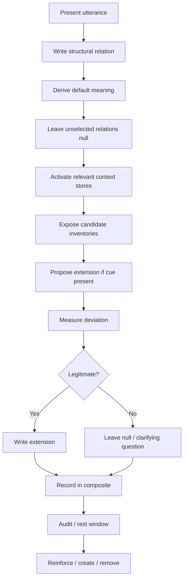

# S2M Relational Mapping Proposal

**Date:** 2026-11-20  
**Status:** Proposal. Independent of current requirements definitions of meaning. Not a definitive account.  
**Door:** This page is linked from the short-sim README so a Frontier AI or new session can find it.  
**Implementation contract:** s2m_program_reference.md — concrete data shapes, attachment point, non-mutation rules, and first-seed acceptance criteria. Read both before coding.

**Refinement:** The mechanical model of how Path A traverses IdOB relational space (structure → legal candidates → evidence correspondence → directional discrimination) is now recorded in [s2m_idob_traversal_proposal.md](s2m_idob_traversal_proposal.md). That document refines this conceptual work; it does not erase the five-stage distinction, default meaning, or the working formulation below. See also [s2m_index.md](s2m_index.md).

## Working formulation of meaning (research hypothesis)

Meaning is the contextually resolved relational structure that the current utterance, its qualifiers, available relational knowledge, applicable categories, and context make relevant.

This working formulation treats meaning as a potentially structured relational configuration rather than a single object, category, relation, or reported response. The relational structure that is available or resolved may be deeper than the bounded projection needed for the current conversational goal. The composition mechanism, meaning-projection contract, identity mechanism, and entropy relationship remain open research questions. This is a research hypothesis only; it does not alter the five-stage S2M model, Framework v1, Qualification v1, or the current bounded realization.

## Organizing principle

When no contextual or category-selection cue is active, S2M shall preserve the utterance's minimal structurally licensed semantic relation as its default meaning. Candidate interpretations remain available but unselected.

This principle is first-class. Default meaning is derived from the structural relation established by the floor. It is not selected from a candidate interpretation inventory.

## Why

Structure-to-meaning is currently fuzzy because the bridge constructs have not been made visible. The goal is a legitimate growth path that starts from a seed (one explicit relation + explicit nulls) and expands only through controllable legitimation.

Meaning sits in relations that are present and relations that remain only potential. This proposal records the process that emerged from discussion so it can be seen, trained, tested, and scaled without inventing links.

A central observation is:

> **The word interpretation list is where meaning slips in.**

This does not mean that an interpretation list is *the meaning* of a word or sentence, nor that knowing the list means knowing or understanding the meaning of an utterance. The list exposes possible meaning relations. The complete utterance constrains those possibilities toward a finite composite specific to that occurrence.

## The S2M distinction (five stages)

S2M exposes five conceptually distinct stages for every realized utterance:

1. **Structural relation** — what the floor actually established.
2. **Default meaning** — the minimal semantic relation licensed by that structure, with no special context or category cue.
3. **Candidate interpretation space** — available possible interpretations for relevant endpoints and relations, tagged by interpretation major and subcategory; unselected by default.
4. **Legitimized interpretive extension(s)** — admitted candidates that satisfy the applicable structural licensing conditions and are therefore materialized as extensions.
5. **Finite customized composite** — the default meaning plus any legitimized interpretive extensions.

These stages remain distinct. Default meaning exists even when no cue is active and does not depend on the candidate inventory.

## How

- Pre-train six context stores independently.
- At runtime activate only the relevant subset for the current exchange.
- Write the explicit structural relation the present structure establishes; leave all others null.
- Derive the default meaning from that structural relation.
- Expose candidate interpretation inventories for relevant endpoints and relations.
- Organize those candidates descriptively by interpretation major and subcategory.
- Use the complete utterance and active space to constrain which candidates are available for consideration.
- Propose further relations only from active context stores and interpretation majors when a cue is present.
- Measure deviation from the licensed region established by the structural relation and default meaning.
- Legitimate or refuse: write an extension only if the proposed relation is within the licensed region and is supported by the active cue; otherwise leave null (or emit clarifying question).
- Build the finite composite from the default plus any relations that have been legitimized.
- Audit (periodic, continuous, or rest/sleep window) for coherence, deviation size, unlegitimized links, and null stability.
- Engineering operations: reinforce, create (only after legitimation), or remove.

## Context stores

The following six stores describe sources involved in the S2M process. They are distinct from interpretation majors.

1. **Further utterance** — local continuations and clarifying forms.
2. **World view** — a priori noun–relation map (basic library lives here).
3. **Social / situational frame** — roles, politeness, setting.
4. **Linguistic context** — anaphora, contrast, scope, force.
5. **Legitimation / refusal** — question, correction, agreement/refusal signals.
6. **Time / sequence** — deviation windows, recency, re-opening.

Each can be loaded or trained separately. Overlap is handled at runtime by activating only relevant stores and materializing composition only for relations under check.

## Interpretation majors and subcategories

Candidate associations are organized descriptively under an interpretation major and subcategory. These are distinct from the context stores above.

| Interpretation major | Subcategories |
|-------|---------------|
| **Affective / experiential** | emotional-tone, bodily-felt, mood, valence |
| **Perceptual / sensory** | color, spatial-extent, visual-quality, sensory-modality |
| **Physical / compositional** | material, structure, natural-kind, composition |
| **Perspectival / situational** | viewpoint, typical-context, orientation, accessibility |
| **Mental** | cognitive, attentional, conceptual, clarity |
| **Spiritual** | transcendent, unbounded, sacred-associative, elevating |
| **Social** | shared, collective, interpersonal, cultural-common |
| **Metaphysical** | ontological-status, essence, categorical-being, ultimate-ground |

**Metaphysical** is included as its own major.

Each candidate can sit under one major and one subcategory. The organization remains descriptive and extendable. Subcategories can be added later without requiring the majors themselves to change.

The classification applies to the association, not necessarily to the endpoint as an intrinsic property. The existence of a candidate does not make it active for every occurrence. Selection remains specific to the utterance and active space.

## Default meaning

Default meaning is the minimal semantic relation licensed by the structural relation. It is derived from structure, not looked up from a candidate inventory. It exists when no contextual or category-selection cue is active. It does not require an associative interpretation to be selected and does not depend on the candidate inventory to establish the basic propositional content.

Exact canonical relation vocabulary (for example, has_state, state/property, is_located_on) remains open. The requirement is that the content of the default preserve the structural crossing.

## Candidate interpretation space

Relevant endpoints and, where appropriate, structural relations may have candidate interpretation inventories. These are available possibilities, not automatically meaning. They remain visibly unselected until something legitimately activates them.

The inventories are associated with endpoints and relations rather than assuming all meaning resides in individual words. This distinction matters for relational structures such as locatives and interrogatives.

## Legitimized interpretive extension

A contextual or category cue may subsequently legitimize one or more candidates. Contextual candidate admission determines which available candidates are considered for structural assessment; structural legitimation determines which admitted candidates are permitted as extensions. An extension is added only after legitimation. It does not appear merely because it is present in an inventory. Extensions are additions to the default meaning, not replacements for it.

## Customized composite

The final finite customized composite contains:
- the structurally licensed default meaning; plus
- any legitimized interpretive extensions.

This conceptual term denotes the occurrence-specific result expressed by the S2M result structure (default meaning co-present with legitimized extensions). It does not by itself require a separately constructed runtime composite object or an additional processing decision.

This keeps the default stable while allowing plasticity and context-sensitivity. The composite is specific to the utterance. It is not the union of every candidate.

Meaning is proposed to appear in that composite without requiring the stronger conclusion that the system therefore knows or understands what the sentence means.

Inspectable distinctions remain:
1. what structure explicitly established;
2. the default meaning derived from it;
3. what interpretations were available as candidates;
4. what interpretations were legitimized as extensions;
5. what remained unavailable, unselected, refused, or null.

## Canonical three-sentence testbench

The following three sentences serve as the initial canonical testbench. For each: structural relation, default meaning, relevant candidate interpretation inventory, no-cue behavior, and possible non-default extensions.

### A. “The sky is blue.”

**Structural relation:**  
`sky — is — blue`

**Default meaning:**  
The entity sky is characterized by the state/property blue.  
(Canonical relation name open; content is the minimal licensed crossing.)

**Candidate interpretation inventory (endpoints):**  
- sky: openness (mental), higher (perspectival), no boundaries (spiritual), broadening (mental), free (affective), made of gas (physical), surrounds a planet (physical), generally seen from the ground and looking up (perspectival)  
- blue: sadness (affective), depression (affective), cold (affective), dying/dwindling (affective), pristine (perceptual), expansive (mental), clarity (mental), color (perceptual), primary color (perceptual)

**No-cue behavior:**  
Default meaning only. All candidates remain unselected.

**Possible non-default extensions (require cue):**  
sky → affords → openness (mental); blue → evokes → cold (affective). These are not part of the default.

### B. “The book is on the table.”

**Structural relation:**  
book — is — on — table (locative)

**Default meaning:**  
The entity book is located on the entity table.  
(Canonical relation name open; content is the locative placement.)

**Candidate interpretation inventory:**  
- book: object (physical), portable (physical), contains pages (physical)  
- table: support (physical), surface (physical), furniture (physical)  
- locative relation itself: placement, containment-adjacent, stable-position (perspectival)

**No-cue behavior:**  
Default locative meaning only. Candidates remain unselected.

**Possible non-default extensions (require cue):**  
table → provides → support; book → is → object. These do not constitute the default.

### C. “Where is the book?”

**Structural relation:**  
query about the location of book

**Default meaning:**  
A request/query for the location of the entity book; the requested locative continuation remains unresolved/potential.

**Candidate interpretation inventory:**  
- book: object (physical)  
- query structure: information-request (mental), unresolved-location (perspectival)

**No-cue behavior:**  
Default query meaning only. Locative continuation remains potential/null until answered. No endpoint association is selected as the meaning.

**Possible non-default extensions (require cue):**  
None required for the initial testbench. The semantic content of the query arises from the structure itself, not from looking up associations for book. (Any later characterization such as book being “sought” would be an optional interpretive extension only.)

## Expected size

| Scope | Projected relations |
|-------|---------------------|
| Rudimentary (seed + core everyday) | ~10⁴ |
| Single broad culture + common occupations | 10⁵ – 10⁶ |
| Multiple cultures + specialized domains | 10⁶ – 10⁷ |
| Open-ended | grows with training |

Runtime memory stays proportional to active stores and legitimized relations, not library size.

These are projected scaling ranges, not demonstrated capacities. The implementation establishes a mechanism through which increasing relation spaces can be tested.

## Merge / overlap handling (efficient)

- Separate stores.
- Lazy composition: pull only active slices; overlap exists only during the deviation-and-legitimation check.
- Reference, don’t copy.
- Nulls occupy only a marker.
- Active memory ∝ relations actually used.

## Scale capability

The structure is intended to remain the same as the relation space grows. Growth occurs through additional relations passing through the same selection and legitimation process. No new store or write path should be required merely because more associations, subcategories, or interpretive spaces are available.

Seed state (one written relation + nulls) remains a legal state at any scale.

This is presently an architectural scalability proposition. Increasing relation counts must be tested to establish how far the implementation actually scales.

## What portion is trained / what we train on

- **Trained:** each context store independently (a priori maps).
- **Train on:** observed or curated relations within that store (everyday objects/events for world view; common continuations for further utterance; etc.).
- **Interpretation inventories:** candidate associations organized by interpretation major and subcategory.
- **Not pre-trained:** every possible path. Plasticity allows new relations to be legitimized later.
- **Runtime:** only relevant stores and interpretation slices are activated; unused stores stay cold.

An interpretation inventory need not enumerate every meaning in advance. Its purpose is to provide an extendable relational space from which finite selections can be made.

## Noun vs verb / relationship

Nouns are only endpoints. Meaning is not reduced to object or attribute collection.

The structural floor establishes present relations between endpoints. Default meaning is derived from that relation. Interpretation inventories then expose possible relations associated with those endpoints and relations. The complete utterance constrains which possibilities can participate in its customized composite.

The process therefore remains relational: write the present connection, derive the default, expose possible meaning relations, select and legitimate only those appropriate to the occurrence, and leave further connections null or potential.

Object/attribute collection by itself is not the bridge.

## What the mapping depends on

Observation of the mapping from structure toward meaning includes:

- the relation the floor emits;
- the default meaning derived from it;
- the explicit nulls;
- the candidate interpretation relations made available;
- the active interpretation major/subcategory space;
- the finite selections proposed for the utterance;
- the deviation of a proposed relation;
- the legitimation or refusal decision; and
- the resulting customized composite.

The visible bridge is that process made inspectable and re-runnable.

## Block diagram — mapping process



## Plasticity of the mind

The mind is trained (a priori maps) yet plastic. New relations can be built controllably:

```text
unexpected continuation
→ deviation check
→ legitimation against licensed region
→ write or refuse
```

Not every path or interpretation must be pre-trained.

The interpretation space is therefore extensible. New associations and subcategories may enlarge what is available without requiring every possible future composite to have been enumerated beforehand.

Plasticity operates on possible relations while legitimation controls which relations become part of an accepted composite.

## Audit, safety, down time

- **Audit:** periodic, continuous, or both. Inspects coherence of written relations, deviation sizes, unlegitimized links, null stability.
- **Safety:** only legitimized relations are written; clarifying question is the response to large deviation; engineering view can remove unwanted links.
- **Down time / rest / sleep:** protected window for thorough audit and light reorganization without response load.

The availability of an association in an interpretation inventory does not itself legitimate that association for the current utterance.

## Relationships established in conversation

Relations can be written during the exchange itself when a clarifying step legitimizes them. Example:

- Speaker: “The sky is blue.”
- Structural relation and default meaning written. All further null.
- Interpretation inventories expose possible relations for sky and blue.
- Speaker: “meaning it is hot.”
- Listener / system: “What do you mean by, it is hot?” (deviation; relation not yet written).
- If subsequent information legitimizes a link, it is written as an extension; otherwise it stays null.

Further examples:

- “Where is the book?” → query default written; locative continuation remains potential until answered.
- Social frame shift (formal vs casual) activates different frame slice; same sentence can license different continuations.

The conversation can therefore change which relations are available or legitimized without requiring the original word to possess one fixed meaning.

## What is and is not claimed

This proposal makes a deliberately bounded claim.

It proposes that **the word interpretation list is where meaning slips in**: the point at which structural endpoints gain access to possible meaning relations.

It further proposes that the complete utterance can constrain these possibilities into a finite, customized composite consisting of the default meaning plus any legitimized extensions.

It does **not** claim that:

- an interpretation list is itself the meaning of a word;
- combining all interpretation lists yields the meaning of a sentence;
- the candidate inventories or interpretation majors are the meaning;
- the system thereby knows or understands what the sentence means.

The IdOB traversal proposal supplies a mechanical account of how structural legality and explicit evidence correspondence can produce a justified informational state without requiring comprehensive meaning. The five-stage distinctions and this working formulation remain intact.
